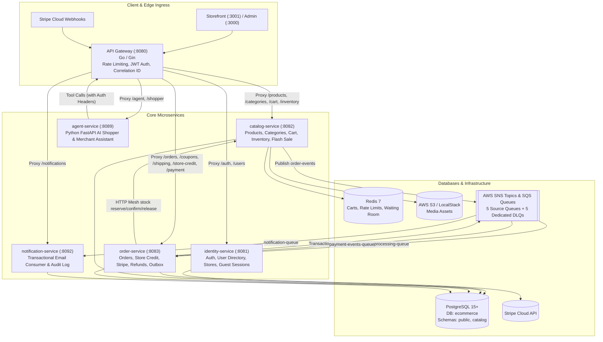

<div align="center">
  <h1>ShopSwift — Microservices Backend</h1>
  <p><strong>Cloud-native, event-driven e-commerce backend powered by Go, Python FastAPI, PostgreSQL, Redis, and AWS SNS/SQS.</strong></p>

  [](https://golang.org)
  [](https://python.org)
  [](https://www.postgresql.org)
  [](https://redis.io)
  [](https://www.docker.com)
  [](https://localstack.cloud)
  [](https://stripe.com)
</div>

---

## 📋 Platform Overview

The **ShopSwift Backend** is an enterprise-ready microservices platform engineered for high-concurrency e-commerce operations. It consolidates domain logic into resilient, low-latency services with zero redundant network hops, backed by an edge API gateway, relational PostgreSQL storage, Redis caching and queue contention engines, and an asynchronous event mesh powered by AWS SNS/SQS.

---

## 🏛️ System Architecture



---

## 🌐 Service & Port Matrix

| Service | Port | Technology | Primary Data Store | Core Responsibilities |
|:---|:---:|:---|:---|:---|
| **api-gateway** | `8080` | Go 1.26 / Gin | Redis (rate limits) | Edge reverse proxy, JWT termination, header sanitization/injection (`X-User-*`), request correlation (`X-Request-ID`), rate limiting |
| **identity-service** | `8081` | Go 1.26 / Gin | Postgres (`users`, `refresh_tokens`, `addresses`, `stores`) | Authentication, password hashing, token rotation family, guest checkout sessions (`/auth/guest`), server-side user search & filtering |
| **catalog-service** | `8082` | Go 1.26 / Gin | Postgres (`catalog` schema) + Redis + S3 | Products, category hierarchy, batch product counts, Redis shopping cart, stock reservations, FairPass flash sale waiting room |
| **order-service** | `8083` | Go 1.26 / Gin | Postgres (`orders`, `coupons`, `payments`, `store_credit_*`) + SQS + Stripe | Idempotent checkout, store credit double-entry ledger, zone shipping, Stripe checkout with address forwarding, full/partial refunds, transactional outbox |
| **agent-service** | `8089` | Python 3.11+ / FastAPI | Postgres (`agent_audit_log`) | Conversational AI assistant, personal shopper copilot (`/shopper/query`, `/stream`), multi-provider LLM fallback (Ollama, Groq, OpenAI, Gemini) |
| **notification-service** | `8092` | Go 1.26 / Gin | Postgres (`notification_logs`) + SQS | Asynchronous transactional email consumer, SMTP dispatch, event deduplication, delivery audit trail |
| **OpenAPI Docs UI** | `8099` | Swagger UI | — | Interactive API documentation viewer |
| **LocalStack** | `4566` | AWS Emulator | S3, SNS, SQS | Local emulation of AWS S3 buckets, SNS topics, SQS queues and DLQs |
| **PostgreSQL** | `5432` | Postgres 15+ | `ecommerce` DB | Master relational database; 24 SQL migration files (`000001`–`000025`, `000008` absent) |
| **Redis** | `6379` | Redis 7 Alpine | In-memory | Session carts, gateway rate limits, flash sale waiting room queues, idempotency caches |

---

## ⚡ Core Engineering Capabilities

### 1. 💳 Store Credit & Payment Allocation Engine (`000025_store_credit`)
- **Accounts & Balances**: User- and store-scoped credit accounts tracking `available_amount` and `held_amount` in integer minor units (e.g. pence/cents) to prevent floating-point rounding errors.
- **Immutable Double-Entry Ledger**: All fund adjustments (`grant`, `debit`, `hold`, `capture`, `release`, `refund`) write immutable records with idempotency keys, reasons, and administrator audit metadata.
- **Split-Tender Allocation**: Orders support multi-payment allocation (`order_payment_allocations`), allowing customers to pay partially with store credit and complete the balance via Stripe, or pay 100% via store credit without hitting external payment gateways.

### 2. 💸 Stripe Order Refund Engine (`POST /orders/:id/refund`)
- Direct integration with Stripe SDK (`stripe.RefundParams`) accepting full or partial refund amounts and custom business reasons.
- State machine validations ensure refunds only execute against eligible states (`paid`, `fulfilled`, `completed`).
- Automatically updates payment status, logs transaction payloads, transitions order status to `refunded`, restocks catalog inventory, and publishes `payment_refunded` events.

### 3. 🎟️ FairPass Flash Sale Waiting Room (`/inventory/flash-sale/*`)
- High-concurrency queue protection built with Redis sorted sets to manage extreme traffic spikes during limited-quantity drops.
- **Fair Admission**: Customers enter the queue (`/enter`), receive position updates (`/status`), and are granted temporary claim tokens (`/claim`) with strict TTL expiration.
- Prevents database contention and guarantees zero overselling under heavy load.

### 4. 🛒 Dynamic Basket Optimizer (`POST /promotions/optimize-basket`)
- In-process promotion engine evaluating shopping basket contents against promotional discount rules, free shipping thresholds, and bundled product incentives.

### 5. 🤖 AI Personal Shopper & Multi-Provider LLM (`agent-service`)
- Natural-language shopping assistant supporting streaming responses (`/shopper/query/stream`).
- Provider abstraction supporting local models via **Ollama** (`qwen2.5:7b`), **Groq** (`llama-3.3-70b-versatile`), **OpenAI**, or **Google Gemini** with automatic failover.
- All agent tool invocations re-enter the API Gateway with forwarded user authorization and are logged to `agent_audit_log`.

### 6. 🚀 Frictionless Guest Checkout Session (`POST /auth/guest`)
- Generates authenticated guest sessions allowing unregistered customers to add items to cart, compute shipping rates, apply coupons, and checkout seamlessly.

### 7. 🔍 Server-Side Search, Filtering & Pagination
- **Identity**: `GET /users` with search across name/email/phone, role filtering, and dynamic sorting.
- **Catalog**: `GET /categories` with pagination and batch product count queries (`CountByCategoryIDs`), eliminating $N+1$ query overhead.

---

## 📁 Repository Structure

```text
E-Commerce-backend/
├── Dockerfile                         # Production multi-stage Docker build
├── start.sh                           # Container startup script with transaction pooler lock handling
└── backend/
    ├── api-gateway/                   # Edge reverse proxy (:8080)
    │   ├── middleware/                # Rate limiting, JWT termination, Request correlation
    │   └── routes/                    # Public, protected, and admin route routing tables
    │
    ├── pkg/common/                    # Shared Go packages
    │   ├── database/                  # Connection pooling, dialectors, and ping checks
    │   ├── internalauth/              # Service mesh mutual authentication middleware
    │   └── utils/                     # Encryption, logging, and error utilities
    │
    ├── services/
    │   ├── identity-service/          # Authentication & user directory (:8081)
    │   ├── catalog-service/           # Products, categories, cart, inventory, flash sale (:8082)
    │   ├── order-service/             # Orders, store credit, Stripe refunds, outbox (:8083)
    │   ├── agent-service/             # Python FastAPI AI conversational assistant (:8089)
    │   └── notification-service/      # Transactional email worker (:8092)
    │
    ├── migrations/                    # 24 golang-migrate migration pairs (+ legacy/ scripts)
    ├── tools/loadtest/                # k6 baseline and flash sale contention test scripts
    ├── docs/                          # OpenAPI 3.0 specification & architectural guides
    ├── infrastructure/aws/            # Deployment scripts and Terraform for AWS (SQS/DLQ, S3, OIDC)
    ├── docker-compose.yml             # Core services Docker Compose definition
    ├── docker-compose.deploy.yml      # SHA-pinned image override for EC2 deploys
    ├── docker-compose.dev-ports.yml   # Host port exposure override
    └── scripts/                       # dev-up, migration, seeding, backup/restore, tunnel, and verification scripts
```

---

## 🚀 Getting Started

### Prerequisites
- **Docker & Docker Compose** (v20.10+)
- **Go** 1.26 (per `backend/go.work`, optional, for local development outside Docker)
- **k6** (optional, for load testing)

### 1. Start the Local Stack (Docker Compose)
```bash
cd backend

# Copy sample environment configuration
cp -n .env.example .env

# Start Postgres, Redis and all services
docker compose up -d --build
```

Endpoint check:
- **API Gateway**: [http://localhost:8080/health](http://localhost:8080/health)
- **OpenAPI Swagger UI**: [http://localhost:8099](http://localhost:8099)

> `scripts/dev-up.sh` and `.env.example` still reference LocalStack (`docker-compose.localstack.yml`), which is not in the repo. Local dev runs without LocalStack; S3 and SQS calls need a real AWS account or a separately run emulator.

### 2. Apply Database Migrations
```bash
cd backend
./scripts/migrate.sh up
```

### 3. Seed Demo Data
```bash
cd backend

# 1. Seed catalog products, categories, and inventory stock
./scripts/seed_catalog.sh

# 2. Seed demo product images into LocalStack S3
python3 scripts/seed_catalog_images.py

# 3. Seed users, addresses, orders, and coupons
./scripts/seed_postgres_data.sh
```

Demo administrator credentials:
- **Email**: `merchant.owner@shopswift-demo.test`
- **Password**: `Demo123!`

---

## 🗄️ SQL Migrations Guide

The platform maintains 24 migration files (numbered `000001`–`000025`; `000008` does not exist) managed by `golang-migrate`:

| Migration | Focus / Area | Key Changes |
|:---|:---|:---|
| `000001` | Baseline | Core schemas: users, products, categories, orders, payments |
| `000002` | Performance | Soft-delete partial indexes |
| `000003-000006` | Auth Hardening | Rate limiting, refresh token family, login lockout, hashed codes |
| `000007` | Messaging | Order transactional outbox table |
| `000009` | AI Audit | Agent audit log table for prompt/tool call tracking |
| `000010` | Traceability | Payment correlation ID for Stripe webhook tracing |
| `000011` | Messaging | Payment transactional outbox table |
| `000012-000014` | Integrity | Referential integrity, history triggers, currency tracking |
| `000015-000016` | Catalog Isolation | PostgreSQL schema `catalog` and inventory reservation tables |
| `000017-000019` | Storage & Queues | Message queue tables, storage buckets, code expirations |
| `000020-000022` | Multi-Tenancy | Multi-tenant stores, store scoping, and subscription plans |
| `000023` | Compatibility | Integer column alignment with Go models |
| `000024` | Admin Operations | Admin portal tables (support tickets, returns, reviews, activity logs) |
| `000025` | Store Credit | Store credit accounts, immutable ledger, and payment allocations |

---

## 🧪 Testing & Verification

```bash
cd backend

# Run unit tests across all Go workspace modules
go test ./...

# Run unit tests in order-service
cd services/order-service && go test -v ./...

# Run Python agent unit tests
cd ../agent-service && pytest

# Verify SQS queue and DLQ redrive policies (AWS or a LocalStack endpoint you run yourself)
cd ../.. && LOCALSTACK_ENDPOINT=http://localhost:4566 ./scripts/verify_sqs_dlq.sh

# Run k6 load test baseline
cd tools/loadtest && k6 run --env GATEWAY_URL=http://localhost:8080 k6-loadtest.js

# Run flash sale contention load test
k6 run --env GATEWAY_URL=http://localhost:8080 k6-flashsale.js
```

---

## 🔒 Security & Resilience Standards

- **Perimeter Isolation**: Gateway blocks all external requests matching `/internal/*` with HTTP 403.
- **Mesh Authentication**: Inter-service calls require the shared `INTERNAL_SERVICE_TOKEN` via `internalauth.Require()`.
- **Identity Header Sanitization**: Incoming client headers `X-User-ID`, `X-User-Role`, and `X-User-Email` are stripped before forwarding, replaced exclusively with cryptographically verified claims from the JWT.
- **Stripe Idempotency**: Stripe webhook events are signature-verified and deduplicated against `stripe_processed_events`.
- **Outbox Publisher Reliability**: Order and payment events use transactional outbox tables with atomic leases, retrying with exponential backoff and preventing message loss during network partitions.

---

## 👨‍💻 Author

**Yash Rajoria** — [GitHub](https://github.com/yashrajoria) · [LinkedIn](https://www.linkedin.com/in/yashrajoria)
