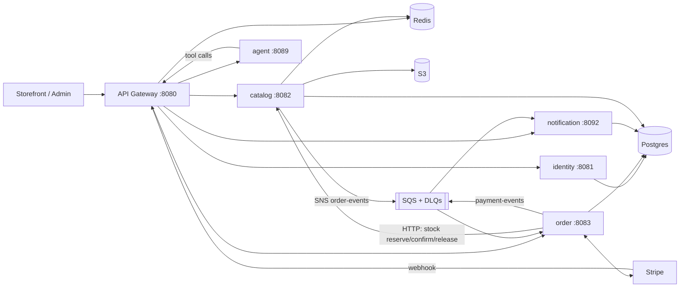

<div align="center">
  <h1>ShopSwift — Microservices Backend</h1>
  <p><strong>Scalable e-commerce backend: Go microservices, Postgres, Redis, SNS/SQS</strong></p>

  
  
  
  
  
</div>

---

## Overview

ShopSwift backend is a Go (plus Python agent) microservices platform with an API gateway and domain services. Local development uses Docker Compose + **LocalStack** for S3, SNS, and SQS. Cloud deployments use the PostgreSQL-backed messaging adapter, so they do not require AWS SNS/SQS credentials.

## Architecture (short)

| Layer | Role |
|-------|------|
| **API Gateway** `:8080` | Routing, cookies/auth headers, rate limits, correlation / request IDs |
| **Domain services** | Identity, catalog, order, notification, agent |
| **Data** | Postgres (transactions; catalog/inventory in schema `catalog`), Redis (cart/cache/idempotency), S3 (images) |
| **Messaging** | SNS topics → SQS queues (checkout, payment, notifications) |



See [MICROSERVICE_ARCHITECTURE.md](MICROSERVICE_ARCHITECTURE.md), [SERVICES_AND_DATABASES.md](SERVICES_AND_DATABASES.md), [SERVICE_ISSUES_AND_AUDIT.md](SERVICE_ISSUES_AND_AUDIT.md), [CLAUDE.md](CLAUDE.md), [../ORCHESTRATOR.md](../ORCHESTRATOR.md) (Multi-Agent Dispatcher & Catalog), [.github/agents/](.github/agents/), [backend/docs/architecture.md](backend/docs/architecture.md), [backend/docs/data-and-messaging.md](backend/docs/data-and-messaging.md), and [backend/docs/best-practices-and-gaps.md](backend/docs/best-practices-and-gaps.md).

The order-service outbox publisher and its at-least-once delivery behavior are documented in [backend/services/order-service/README.md](backend/services/order-service/README.md).

### Request correlation and reliability

The gateway normalizes `X-Request-ID` and `X-Correlation-ID` to one value. Downstream HTTP calls forward both headers; checkout, payment, and notification events carry optional `correlation_id` metadata through SNS/SQS retries and outbox delivery. Payment records persist the value so Stripe webhook events retain the original checkout correlation. Missing IDs are generated only at the gateway or legacy event entry points.

Phase 1 integrity protections are covered by regression tests: coupon usage increments are atomic, order persistence failures compensate inventory reservations, cart checkout validates products in one batch, and internal service authentication fails closed. User address ownership is currently N/A because no address CRUD routes are registered.

### Services and ports

| Service | Port | Stack | Primary storage |
|---------|------|-------|-----------------|
| api-gateway | 8080 | Go / Gin | Redis (rate limit) |
| identity-service | 8081 | Go | Postgres |
| catalog-service | 8082 | Go | Postgres + Redis + S3 |
| order-service | 8083 | Go | Postgres + SQS/SNS + Stripe |
| agent-service | 8089→8000 | Python FastAPI | Postgres (agent audit log); calls domain APIs via gateway |
| notification-service | 8092 | Go | Postgres + SQS |
| docs (Swagger UI) | 8099 | swagger-ui | — |
| LocalStack | 4566 | AWS emulator | S3/DDB/SNS/SQS |
| postgres | 5432 | Postgres | DB `ecommerce` |
| redis | 6379 | Redis 7 | — |

## Tech stack

- **Languages:** Go 1.26 (workspace), Python (agent-service)
- **HTTP:** Gin; gateway proxies to domain services
- **Postgres:** identity, order, notification
- **Postgres (schema `catalog`):** products, categories, inventory (not MongoDB)
- **Redis:** cart, checkout idempotency replay, gateway rate limit, product cache
- **AWS (or LocalStack):** S3, SNS, SQS, Secrets Manager (optional), CloudWatch (optional)
- **Payments:** Stripe + stripe-cli webhook forwarding in Compose

## Project structure

```
E-Commerce-backend/
└── backend/
    ├── api-gateway/
    ├── pkg/common/                 # Shared Go libs (auth, db, events, messaging, telemetry)
    ├── services/
    │   ├── agent-service/          # Python AI agent
    │   ├── catalog-service/
    │   ├── identity-service/
    │   ├── notification-service/
    │   ├── order-service/
    ├── docs/                       # Architecture, OpenAPI, API md
    ├── migrations/                 # SQL migrations (golang-migrate)
    ├── localstack/                 # LocalStack image + bootstrap
    ├── infrastructure/aws/         # Terraform / deploy helpers
    ├── docker-compose.yml
    ├── docker-compose.localstack.yml
    └── scripts/dev-up.sh           # Recommended local start
```

## Getting started

### Prerequisites

- Docker + Docker Compose
- Go 1.26+ (optional, for running services outside Docker)
- Copy `backend/.env.example` → `backend/.env` and set secrets (JWT, Stripe, SMTP, Postgres password)

### Run the full stack (recommended)

Local AWS emulation is **required** for notification, order, payment, and product flows:

```bash
cd backend
cp -n .env.example .env   # if needed
./scripts/dev-up.sh
# equivalent:
# docker compose -f docker-compose.yml -f docker-compose.localstack.yml up -d --build
```

Useful URLs:

- Gateway: http://localhost:8080  
- OpenAPI UI: http://localhost:8099  
- LocalStack: http://localhost:4566  

### Migrations

```bash
cd backend
./scripts/migrate.sh up
```

The production image includes the migration files and runs pending SQL migrations before starting any service. Set `RUN_MIGRATIONS=false` only when migrations are applied by a separate deployment step. Local Compose defaults `ALLOW_AUTO_MIGRATE=true` for DX.

### Production image deployment

The main CI workflow runs the tests, migration checks, linting, and Docker
validation before building the production image. On `main`, it publishes the
image to GitHub Container Registry with both an immutable commit-SHA tag and
the `main` tag:

```text
ghcr.io/yashrajoria/shopswift-backend:<commit-sha>
```

Render should be configured as a Docker image service using:

```text
ghcr.io/yashrajoria/shopswift-backend:main
```

The Render deploy hook runs only after the image has been published. Render
then pulls the image produced by that CI run instead of rebuilding the
repository Dockerfile. Keep the package accessible to Render using a public
package or Render registry credentials.

### Docs

- [Architecture](backend/docs/architecture.md)
- [Data & messaging](backend/docs/data-and-messaging.md)
- [API docs index](backend/docs/api/README.md)
- [Best practices & gaps](backend/docs/best-practices-and-gaps.md)
- [AWS queue infrastructure](backend/infrastructure/aws/terraform/README.md)

LocalStack bootstraps five source SQS queues and five explicit DLQs. Existing source queues are reconciled with their redrive policy on startup. Run `backend/scripts/verify_sqs_dlq.sh` for policy checks, or pass `--exercise` to verify end-to-end redrive in a disposable environment.

## Security

- Auth service issues JWT / cookies; gateway forwards identity
- Secrets via env / IAM / LocalStack secrets (not committed)
- Stripe webhooks verified with signing secret; event ID dedup

## Roadmap (remaining)

- [ ] Broader contract / SQS consumer tests in CI
- [ ] Full OpenAPI agent-ready pass (`operationId`, error schemas)
- [ ] Prometheus / OpenTelemetry exporters
- [ ] Remove dormant shipping DB code

## Author

**Yash Rajoria** — [GitHub](https://github.com/yashrajoria) · [LinkedIn](https://www.linkedin.com/in/yashrajoria)
