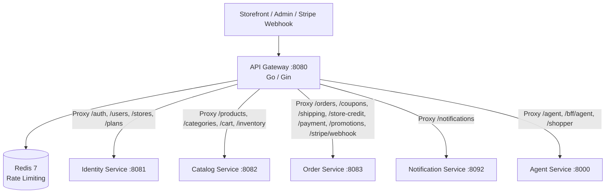

# 🚪 API Gateway

The **ShopSwift API Gateway** is the single edge entry point for all frontend and client traffic. Built in **Go 1.26** with **Gin**, it runs on port `8080` and is responsible for JWT authentication, header sanitization and injection, distributed rate limiting, request correlation tracking, and reverse proxy routing to domain microservices.

---

## 🏛️ Architecture



---

## 🛡️ Core Responsibilities & Security

### 1. Header Sanitization & Identity Injection
To prevent identity spoofing, the gateway strips any incoming client headers matching `X-User-ID`, `X-User-Role`, or `X-User-Email`. After validating the JWT, it injects cryptographically verified values before forwarding requests downstream:
- `X-User-ID`: Authenticated user UUID.
- `X-User-Role`: User role (`admin`, `customer`, `guest`).
- `X-User-Email`: User email address.

### 2. Request Correlation & Distributed Tracing
- `RequestIDMiddleware` ensures every request carries a normalized `X-Request-ID` and `X-Correlation-ID`.
- Downstream services receive both headers, propagating them through HTTP mesh calls, database logs, and asynchronous SNS/SQS event payloads.

### 3. Distributed Rate Limiting
Backed by Redis token bucket rate limiters:
- **Global Rate Limiter**: Applied to every request when Redis is configured.
- **Strict Rate Limiter**: Applied to the public auth endpoints under `/auth/` (`/auth/login`, `/auth/register`, `/auth/guest`, `/auth/resend-verification`, `/auth/refresh`) to mitigate brute-force and credential-stuffing attacks.

### 4. Internal Endpoint Blocking
Requests whose path contains `/internal/` are rejected with `403 Forbidden` by the gateway's proxy handler, so internal-only service endpoints are never reachable from the edge.

---

## 📋 Route Matrix

Routes are registered in `api-gateway/routes/routes.go`. Auth levels: **Public** (no JWT), **Optional JWT** (cart only; guests allowed), **JWT** (any valid token), **Admin** (JWT + `role=admin`).

### 🌐 Public Routes
| Path | Method | Target Service | Purpose |
|:---|:---:|:---|:---|
| `/health`, `/health/live`, `/health/ready` | `GET` | In-process | Liveness; readiness pings Redis |
| `/stripe/webhook` | `POST` | `order-service` | Stripe webhook ingress (signature verified downstream) |
| `/auth/login`, `/auth/register`, `/auth/guest`, `/auth/resend-verification`, `/auth/refresh` | `POST` | `identity-service` | Strict rate limited. Login, registration, guest session, email re-send, token refresh |
| `/bff/auth/refresh` | `POST` | `identity-service` | Alias for `/auth/refresh` used by SSR apps |
| `/auth/verify-email` | `POST` | `identity-service` | Email verification |
| `/products`, `/products/*any` | `GET` | `catalog-service` | Browse products |
| `/categories`, `/categories/*any` | `GET` | `catalog-service` | Browse categories |
| `/coupons/validate` | `POST` | `order-service` | Validate a coupon code |
| `/inventory/flash-sale/enter` | `POST` | `catalog-service` | Enter the FairPass flash sale waiting room |
| `/inventory/flash-sale/status` | `GET` | `catalog-service` | Waiting room queue status |
| `/promotions/optimize-basket` | `POST` | `order-service` | Basket optimizer suggestions |
| `/shopper/query`, `/shopper/query/stream` | `POST` | `agent-service` | AI shopper copilot (regular and streaming) |
| `/stores/by-slug/:slug` | `GET` | `identity-service` | Public store lookup by slug |
| `/plans` | `GET` | `identity-service` | Subscription plans |

### 🔒 Optional-JWT Routes (cart)
| Path | Method | Target Service | Purpose |
|:---|:---:|:---|:---|
| `/cart`, `/cart/*any` | `GET`, `POST`, `PUT`, `DELETE` | `catalog-service` | Cart. Works for guests and signed-in users |

### 🔐 Protected Routes (JWT required)
| Path | Method | Target Service | Purpose |
|:---|:---:|:---|:---|
| `/auth/logout` | `POST` | `identity-service` | Logout |
| `/auth/*any` | `GET` | `identity-service` | Auth GET endpoints |
| `/users`, `/users/*any` | `GET`, `POST`, `PUT`, `DELETE` | `identity-service` | Profile, address and user management. Service enforces access rules |
| `/stores`, `/stores/:id`, `/stores/:id/*` | `GET`, `POST`, `PUT`, `DELETE` | `identity-service` | Store tenant management: members, invites, settings, subscription |
| `/orders`, `/orders/*any` | `GET`, `POST` | `order-service` | Order history and creation |
| `/store-credit/balance`, `/store-credit/ledger` | `GET` | `order-service` | Customer store credit balance and ledger |
| `/store-credit/grants`, `/store-credit/adjustments` | `POST` | `order-service` | Store credit grants and adjustments (owner/admin checks in service) |
| `/store-credit/reconcile` | `GET` | `order-service` | Ledger reconciliation |
| `/payment`, `/payment/*any` | `GET`, `POST`, `DELETE` | `order-service` | Stripe checkout and payment status |
| `/inventory/:productId` | `GET` | `catalog-service` | Stock lookup |
| `/inventory/check` | `POST` | `catalog-service` | Stock check |
| `/inventory/flash-sale/claim`, `/inventory/flash-sale/release` | `POST` | `catalog-service` | Claim or release a flash sale slot |
| `/coupons/:code` | `GET` | `order-service` | Coupon lookup |
| `/shipping/rates` | `POST` | `order-service` | Shipping rate calculation |

### 🛡️ Admin Routes (JWT + `role=admin`)
| Path | Method | Target Service | Purpose |
|:---|:---:|:---|:---|
| `/products`, `/products/*any` | `POST`, `PUT`, `DELETE` | `catalog-service` | Product writes |
| `/categories`, `/categories/*any` | `POST`, `PUT`, `DELETE` | `catalog-service` | Category writes |
| `/orders/*any` | `PUT`, `DELETE` | `order-service` | Order updates |
| `/inventory`, `/inventory/:productId` | `GET`, `POST`, `PUT` | `catalog-service` | Inventory management |
| `/inventory/flash-sale/configure`, `/inventory/flash-sale/reset` | `POST` | `catalog-service` | FairPass waiting room controls |
| `/coupons`, `/coupons/:code` | `GET`, `POST`, `DELETE` | `order-service` | Coupon management |
| `/notifications/log` | `GET` | `notification-service` | Email delivery log |
| `/auth/admin/users` | `POST` | `identity-service` | Create user as admin |
| `/agent`, `/agent/*any` | `ANY` | `agent-service` | Admin AI assistant |

### 📊 BFF Admin Routes (`/bff/admin/*`, JWT + `role=admin`)
| Path | Method | Target Service | Purpose |
|:---|:---:|:---|:---|
| `/bff/admin/dashboard` | `GET` | `order-service` | Dashboard KPIs |
| `/bff/admin/reports/sales` | `GET` | `order-service` | Sales stats |
| `/bff/admin/reports/users`, `/bff/admin/users`, `/bff/admin/users/*any` | `GET`, `POST`, `PUT`, `DELETE` | `identity-service` | Users report and management |
| `/bff/admin/reports/inventory`, `/bff/admin/inventory`, `/bff/admin/inventory/*any` | `GET`, `PUT` | `catalog-service` | Inventory report and management |
| `/bff/admin/products`, `/bff/admin/products/*any` | `GET`, `POST`, `PUT`, `DELETE` | `catalog-service` | Product CRUD. `/products/presign` for S3 uploads |
| `/bff/admin/categories`, `/bff/admin/categories/*any` | `GET`, `POST`, `PUT`, `DELETE` | `catalog-service` | Category CRUD |
| `/bff/admin/orders`, `/bff/admin/orders/*any` | `GET`, `PUT` | `order-service` | Order fulfillment |
| `/bff/admin/coupons`, `/bff/admin/coupons/*any` | `GET`, `POST`, `PUT`, `DELETE` | `order-service` | Coupon management |
| `/bff/admin/notifications`, `/bff/admin/notifications/log` | `GET` | `notification-service` | Notification logs |
| `/bff/admin/stores`, `/bff/admin/stores/*any` | `GET`, `POST`, `PUT`, `DELETE` | `identity-service` | Store admin |
| `/bff/admin/plans`, `/bff/admin/plans/*any` | `GET` | `identity-service` | Plans admin view |
| `/bff/admin/agent/*any` | `ANY` | `agent-service` | Admin AI assistant |

### 🤖 Agent Routes
| Path | Method | Auth | Target Service | Purpose |
|:---|:---:|:---|:---|:---|
| `/bff/agent/*any` | `ANY` | JWT (any role) | `agent-service` | Agent alias used by the admin UI. Gateway does not enforce admin role on this group |

---

## ⚙️ Configuration

| Environment Variable | Description | Default |
|:---|:---|:---|
| `PRODUCT_SERVICE_URL` | Base URL for catalog products | `http://catalog-service:8082` |
| `CART_SERVICE_URL` | Base URL for cart (catalog) | `http://catalog-service:8082` |
| `INVENTORY_SERVICE_URL` | Base URL for inventory (catalog) | `http://catalog-service:8082` |
| `USER_SERVICE_URL` | Base URL for users, stores, plans | `http://identity-service:8081` |
| `AUTH_SERVICE_URL` | Base URL for auth | `http://identity-service:8081` |
| `ORDER_SERVICE_URL` | Base URL for order-service | `http://order-service:8083` |
| `NOTIFICATION_SERVICE_URL` | Base URL for notification-service | `http://notification-service:8092` |
| `AGENT_SERVICE_URL` | Base URL for agent-service | `http://agent-service:8000` |

The gateway also reads its JWT, Redis and CORS settings from the middleware packages (`InitJWTConfig`, `GlobalRateLimiter`, `CORSMiddleware`); see `api-gateway/middleware/` and `api-gateway/main.go` for those variable names.

---

## 🚀 Running Locally

```bash
cd backend/api-gateway
go run .
```

Verify gateway health:
```bash
curl http://localhost:8080/health
```
