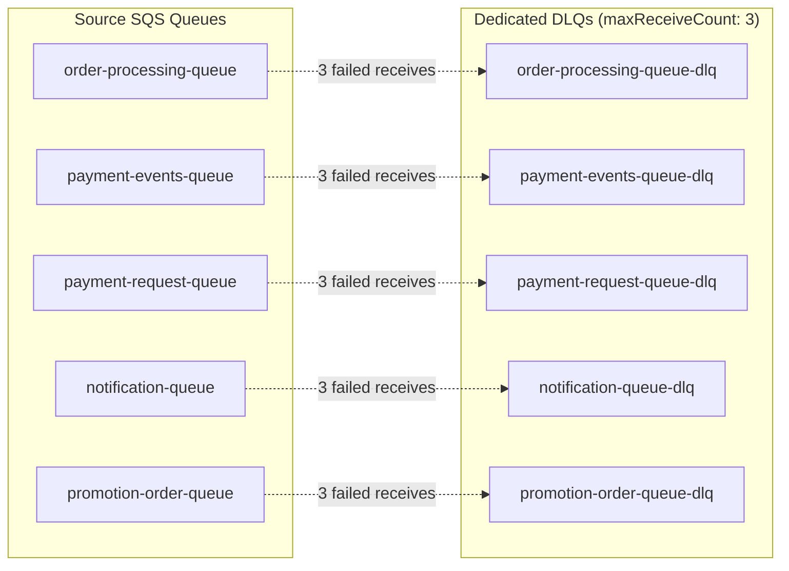

# 🏗️ AWS SQS & Dead Letter Queue (DLQ) Terraform Module

This Terraform module (provider `hashicorp/aws >= 4.0`, Terraform `>= 1.0`, default region `us-east-1`) provisions five source SQS queues, five dedicated Dead Letter Queues (DLQs) with redrive policies, plus the supporting resources listed below.

Note: the running Go services use Postgres-backed queues (`message_queues` table, migration `000017`, `pkg/common/messaging`) and import no AWS SDK, so these resources are not required by current application code.

## Resources

| File | Provisions |
|------|-----------|
| `main.tf` | Provider and Terraform version settings (`hashicorp/aws >= 4.0`, region from `var.aws_region`) |
| `resources.tf` | S3 bucket `var.s3_bucket` (default `shopswift`, private ACL, `force_destroy = true`); 5 SQS source queues + 5 DLQs; CloudWatch log group `/ecommerce/services` (30-day retention); Secrets Manager secret `ecommerce/db_credentials` |
| `iam.tf` | GitHub Actions OIDC role `var.ci_role_name` (default `ecommerce-github-actions-oidc-role`, trusted for `repo:<var.github_repo>:*`), CI policy + attachment, output `ci_role_arn` |
| `outputs.tf` | `s3_bucket`, `sqs_order_processing_url`, `sqs_queue_urls`, `sqs_dlq_urls`, `cloudwatch_log_group`, `region` |
| `variables.tf` | `aws_region`, `s3_bucket`, `sqs_queues`, `sqs_dlqs`, `sqs_max_receive_counts`, `project_name`, `github_repo`, `ci_role_name`; also `ec2_ami`, `ec2_instance_type`, `sns_topic_name`, `sqs_queue_name`, `cloudwatch_log_group_name`, which no resource currently uses |

`terraform.tfvars.example` also sets `ddb_tables`, which is not a declared variable (Terraform warns about it).

---

## 📬 Queue & DLQ Topology



Each source queue is configured with:
- **`visibility_timeout_seconds`**: 30 seconds (hard-coded in `resources.tf`).
- **`redrive_policy`**: Routes to the corresponding DLQ after `sqs_max_receive_counts[<queue>]` receives (default `3`). Queue names come from `sqs_queues`, DLQ names from `sqs_dlqs`.
- Message retention is not set, so AWS defaults apply (including on DLQs).

---

## 🚀 Quick Start (Local & Terraform CLI)

### 1. Initialize & Validate Configuration
```bash
cd backend/infrastructure/aws/terraform

# Initialize without remote backend for validation
terraform init -backend=false
terraform validate
```

### 2. Configure Variables
Copy the template and supply environment-specific parameters:
```bash
cp terraform.tfvars.example terraform.tfvars
```

### 3. Plan & Apply
```bash
terraform plan -out plan.tfplan
terraform apply plan.tfplan
```

A plain `terraform apply` does not write the outputs file. To export outputs to `infrastructure/aws/terraform-outputs.json`, run `infrastructure/aws/deploy_infrastructure.sh apply` instead (it also runs `terraform init` and applies with `-auto-approve`; `plan` mode only writes `plan.tfplan`). Outputs are queue URLs (not ARNs), the S3 bucket, log group and region.

### 4. Sync Terraform Outputs to Application `.env`
Run the automated population helper:
```bash
cd backend/infrastructure/aws
./populate_env_from_terraform.sh
```
This utility requires `jq` and writes `AWS_S3_BUCKET`, `S3_BUCKET_IMAGES`, `AWS_REGION`, `CLOUDWATCH_LOG_GROUP` and `ORDER_SQS_URL` into `.env` two levels above `infrastructure/` (backing it up first). Caveat: it reads `infrastructure/terraform/terraform-outputs.json`, while `deploy_infrastructure.sh` writes `infrastructure/aws/terraform-outputs.json`, so copy/link the file or fix the path first.

---

## 🧪 Verifying Queues & DLQ Redrive Policies

You can verify queue creation and DLQ redrive policies against AWS, or a LocalStack endpoint if you run one (LocalStack is not part of the repo's Compose files; needs the `aws` CLI; env: `LOCALSTACK_ENDPOINT`, `AWS_REGION` default `us-east-1`, `SQS_MAX_RECEIVE_COUNT` default `3`):

```bash
cd backend

# Verify queue attributes and redrive policy wiring
LOCALSTACK_ENDPOINT=http://localhost:4566 ./scripts/verify_sqs_dlq.sh

# Exercise redrive: injects probe messages and asserts DLQ delivery after 3 retries
LOCALSTACK_ENDPOINT=http://localhost:4566 ./scripts/verify_sqs_dlq.sh --exercise
```

*(Note: The `--exercise` flag alters queue state temporarily and should only be executed against LocalStack or disposable test environments).*

---

## 🔒 Security Best Practices

- **Never Commit Credentials**: Never commit `terraform.tfvars` containing live AWS credentials.
- **OIDC Authentication**: In CI/CD pipelines (no Terraform workflow exists yet; `.github/workflows/` has only `ci-main.yml` and `update-commits-badge.yml`), use AWS IAM OpenID Connect (OIDC) roles via `aws-actions/configure-aws-credentials` rather than long-lived AWS Access Keys.
- **Least Privilege**: Application IAM policies should grant `sqs:SendMessage` only to publishers and `sqs:ReceiveMessage` / `sqs:DeleteMessage` only to consuming microservices.
