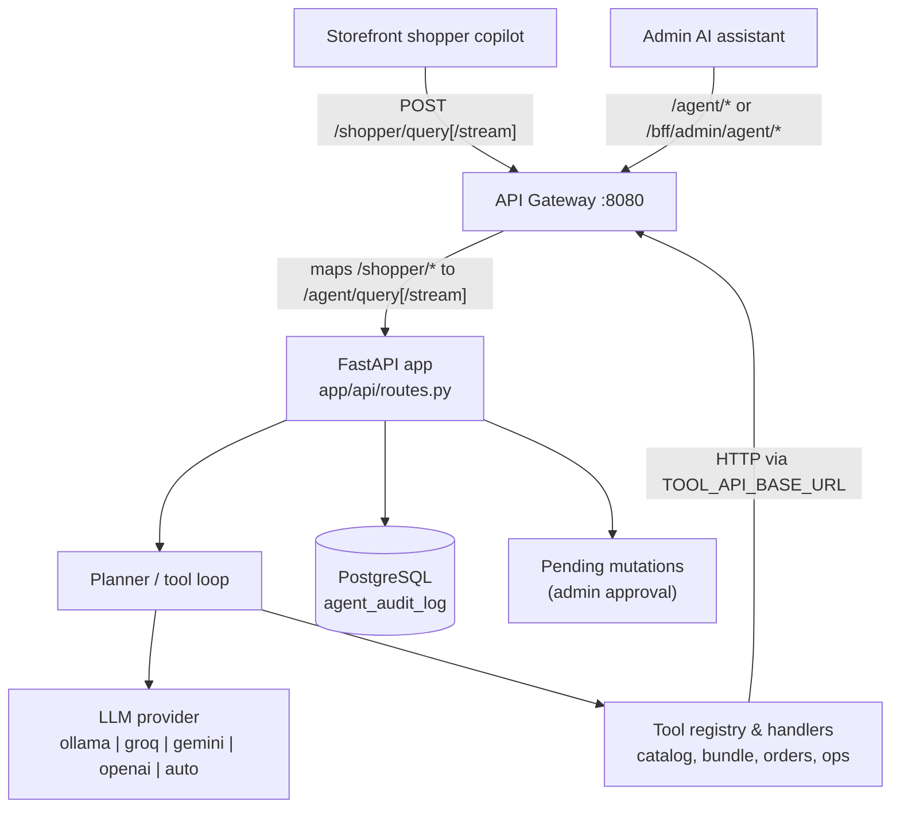

# 🤖 Agent Service

The **ShopSwift Agent Service** is the AI assistant, built with **Python 3.11+** and **FastAPI**. It serves the storefront shopper copilot and the admin AI assistant. It calls LLM providers, runs tools against the API Gateway, holds admin-approved write actions, and writes an audit log. It listens on port `8000` in the container and is published as `8089`.

---

## 🏛️ Architecture



---

## ⚡ Core Capabilities

### 1. Shopper Copilot
- Storefront assistant for product discovery and bundle suggestions. Reached through the gateway's public `/shopper/*` routes.
- `/agent/query/stream` returns streamed output (Server-Sent Events) when `ENABLE_STREAMING` is on.

### 2. Admin AI Assistant
- Admin-only routes behind the gateway's `/agent/*` and `/bff/admin/agent/*` paths.

### 3. LLM Providers
Set with `LLM_PROVIDER`:
- `ollama` (default): local Ollama at `LLM_SERVICE_URL`, model `LLM_MODEL` (default `qwen2.5:7b`).
- `groq`: Groq OpenAI-compatible API, model `GROQ_MODEL` (default `openai/gpt-oss-20b`).
- `gemini`: model `GEMINI_MODEL` (default `gemini-2.0-flash`).
- `openai`: model `OPENAI_MODEL` (default `gpt-4o-mini`), base URL `OPENAI_BASE_URL`.
- `auto`: tries providers in order; see `app/llm/provider.py` for the exact order.

Cloud providers are used only when their API key is set.

### 4. Tools
- Tool handlers live in `app/tools/handlers/`: `catalog.py`, `bundle.py`, `orders.py`, `ops.py`.
- Each tool is validated (`app/tools/validator.py`), run by the executor (`app/tools/executor.py`), and called over HTTP at `TOOL_API_BASE_URL` (the gateway). Requests carry the caller's `Authorization` and correlation headers, so tools can't do more than the caller can.
- `GET /tools` and `GET /agent/tools` list registered tool schemas.

### 5. Pending Mutations (admin approval)
- Write actions the agent proposes are stored as pending mutations instead of running at once.
- Admins review them with `GET /agent/mutations/pending` and `GET /agent/mutations/{request_id}`, then run them with `POST /agent/mutations/{request_id}/confirm`.
- Admin role is checked in the service (`X-User-Role == admin`), on top of the gateway check.

### 6. Watchdog
- `POST /agent/watchdog/scan` (admin) runs a scan (`app/watchdog/sentry.py`) for incidents.

### 7. Audit Log (`000009_agent_audit_log`)
- Records tool calls, pending mutations, and session turns with arguments, results, and timings in `agent_audit_log`.

### 8. Observability
- Logs carry the correlation ID.
- OpenTelemetry export is enabled when `OTEL_EXPORTER_OTLP_ENDPOINT` is set.

---

## 📋 HTTP Surface

The gateway is the public entry point. Auth column is what the service expects. The gateway also checks JWT and admin role on its routes.

| Method | Path | Auth | Description |
|:---|:---|:---:|:---|
| `POST` | `/agent/query` | Gateway JWT | Assistant query (buffered response) |
| `POST` | `/agent/query/stream` | Gateway JWT | Assistant query (streamed) |
| `GET` | `/agent/session/{session_id}` | Gateway JWT | Session history |
| `DELETE` | `/agent/session/{session_id}` | Gateway JWT | Clear session history |
| `GET` | `/tools`, `/agent/tools` | Public | Tool schemas |
| `GET` | `/agent/mutations/pending` | Admin | Pending write actions |
| `GET` | `/agent/mutations/{request_id}` | Admin | One pending action |
| `POST` | `/agent/mutations/{request_id}/confirm` | Admin | Approve and run a pending action |
| `POST` | `/agent/watchdog/scan` | Admin | Run watchdog scan |
| `GET` | `/health` | Public | Liveness and active LLM provider |

Gateway public routes: `/shopper/query` and `/shopper/query/stream` (rewritten to `/agent/query` and `/agent/query/stream`).

---

## ⚙️ Configuration

| Environment Variable | Description | Default |
|:---|:---|:---|
| `ENVIRONMENT` | `production` enables production behaviour | `production` |
| `LLM_PROVIDER` | `ollama`, `groq`, `gemini`, `openai`, or `auto` | `ollama` |
| `LLM_SERVICE_URL` | Ollama chat endpoint | `http://ollama:11434/api/chat` |
| `LLM_MODEL` | Ollama model | `qwen2.5:7b` |
| `LLM_TIMEOUT` | LLM call timeout (seconds) | `30` |
| `GEMINI_API_KEY`, `GEMINI_MODEL` | Gemini key and model | — / `gemini-2.0-flash` |
| `OPENAI_API_KEY`, `OPENAI_BASE_URL`, `OPENAI_MODEL` | OpenAI settings | — / `https://api.openai.com/v1` / `gpt-4o-mini` |
| `GROQ_API_KEY`, `GROQ_BASE_URL`, `GROQ_MODEL` | Groq settings | — / `https://api.groq.com/openai/v1` / `openai/gpt-oss-20b` |
| `ENABLE_STREAMING` | Enable streaming responses | `true` |
| `TOOL_API_BASE_URL` | Gateway base URL for tool calls | `http://api-gateway:8080` |
| `TOOL_TIMEOUT`, `BFF_TIMEOUT` | Tool / BFF call timeouts (seconds) | `20`, `15` |
| `MAX_CONCURRENT_TOOLS` | Parallel tool calls | `5` |
| `MAX_HISTORY_TURNS` | Turns kept per session | `10` |
| `POSTGRES_HOST`, `POSTGRES_PORT`, `POSTGRES_USER`, `POSTGRES_PASSWORD`, `POSTGRES_DB` | Audit log database | `postgres`, `5432`, `postgres`, `postgres`, `ecommerce` |
| `OTEL_EXPORTER_OTLP_ENDPOINT` | Enables OpenTelemetry export | — |
| `DEPLOY_ENV` / `APP_ENV` | Deployment label for telemetry | `local` |

---

## 🚀 Running Locally

```bash
cd backend/services/agent-service

python3 -m venv venv
source venv/bin/activate
pip install -r requirements.txt

uvicorn main:app --host 0.0.0.0 --port 8000 --reload
```

Run tests:
```bash
pytest
```
