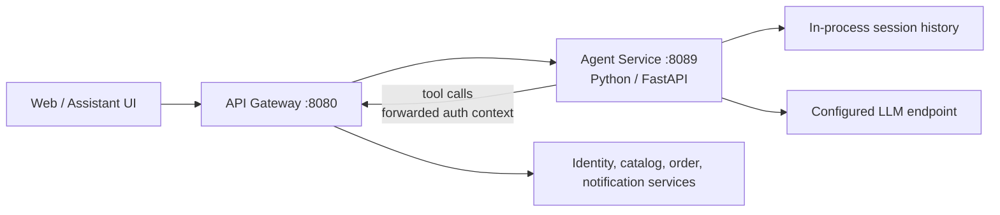
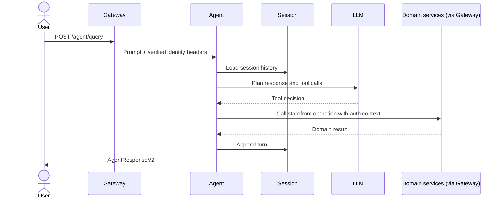

# Agent Service

The agent service is the Python/FastAPI conversational interface for ShopSwift. It runs on port `8089`, keeps short-lived in-process session history, and calls domain APIs through the API gateway (`TOOL_API_BASE_URL`, default `http://api-gateway:8080`) on behalf of the authenticated user. There is no separate BFF process.

## Responsibilities

- Accept natural-language queries and maintain a session conversation.
- Select and invoke tools registered by the agent runtime.
- Forward authorization, cookies, `X-User-ID`, `X-User-Role`, and correlation IDs to the gateway.
- Expose session inspection and clearing for controlled clients.
- Provide health and tool-discovery endpoints.

## Architecture

Tool calls re-enter the gateway so JWT validation, RBAC, and rate limits apply to agent actions exactly as for any client. The service is stateless across process restarts: session history is local memory and is not a durable customer record.

## Query flow

## HTTP surface

| Route | Purpose | Access |
| --- | --- | --- |
| `POST /agent/query` | Run an agent query | Gateway-authenticated or guest context |
| `GET /agent/session/:session_id` | Inspect in-memory history | Controlled/internal use |
| `DELETE /agent/session/:session_id` | Clear session history | Controlled/internal use |
| `GET /tools` and `GET /agent/tools` | List registered tools | Public/runtime discovery |
| `GET /health` | Health status and version | Public |

## Configuration and safety

Configure `TOOL_API_BASE_URL`, LLM endpoint and credentials, request timeouts, and logging. Preserve correlation IDs across downstream calls. Do not persist tokens or sensitive prompts in session logs; session memory should be treated as ephemeral process state.

`LLM_PROVIDER` supports `ollama` (default, model `qwen2.5:7b`), `groq`, `gemini`, `openai`, or `auto`. Tool calls and pending mutations are recorded in the agent audit log (migration `000009_agent_audit_log`). For local development, set `LLM_PROVIDER=ollama` to use Ollama with Groq as an automatic fallback when `GROQ_API_KEY` is configured. Set `LLM_PROVIDER=groq` to use Groq directly with Ollama as the fallback. Groq uses its OpenAI-compatible endpoint at `https://api.groq.com/openai/v1`; keep `GROQ_API_KEY` in the untracked `.env` file only.
