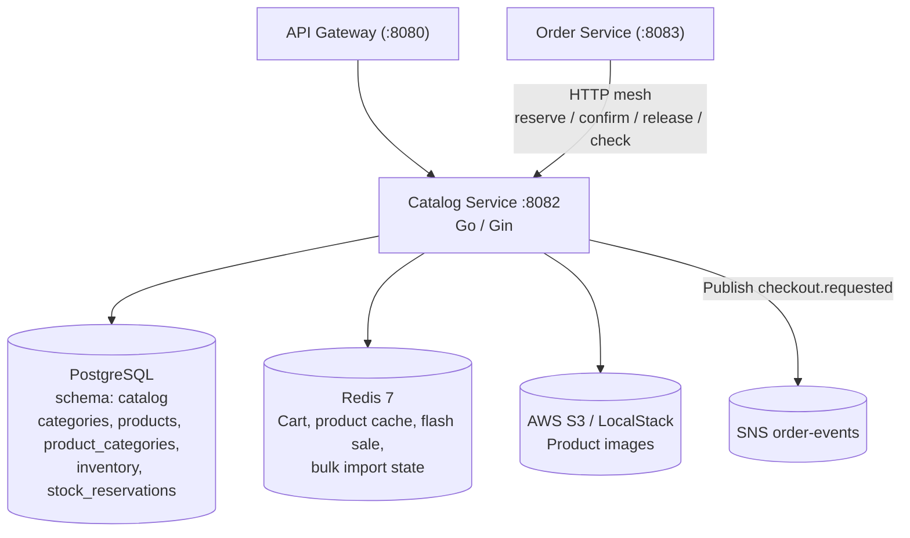

# 📦 Catalog Service

The **ShopSwift Catalog Service** owns products, categories, product images (S3), the shopping cart, inventory stock, and the flash sale waiting room. It absorbed the former product, inventory and cart services. Built in **Go 1.26** with **Gin**, **GORM** and **Redis**, it runs on port `8082` and stores relational data in the `catalog` schema of PostgreSQL.

---

## 🏛️ Architecture



---

## ⚡ Core Capabilities

### 1. Products & Bulk Import
- CRUD for products, with category links.
- `POST /products/bulk/validate`, `POST /products/bulk` and `GET /products/bulk/jobs/:id` run bulk imports as jobs. Bulk state is kept in Redis (`bulk_import:*`) and staged under `BULK_STORAGE_DIR`.
- `POST /products/bulk/delete` deletes several products at once.

### 2. S3 Presigned Image Uploads
- `GET /products/presign` and `POST /products/:id/images/presign` return presigned S3 / LocalStack upload URLs, so clients upload images directly to storage.

### 3. Categories
- List and detail endpoints, admin create/update/delete, and bulk create.
- Category listing is paginated server-side and includes batch product counts (one grouped query, no per-row count).

### 4. Shopping Cart (Redis)
- Carts are stored in Redis under `cart:user:{user_id}` with a 7-day TTL (`CART_TTL` is fixed in code, not an env var).
- `POST /cart/checkout` requires an `Idempotency-Key` header and publishes `checkout.requested` to SNS (`ORDER_SNS_TOPIC_ARN`).
- `DELETE /cart/internal/:user_id` is mesh-only. order-service calls it to clear a cart after payment.

### 5. Stock Reservation
- Stock is reserved per order and product: reserve, confirm and release each run in one database transaction.
- Reservations are idempotent per `(order_id, product_id)`.
- Products are locked in ID order to avoid deadlocks.
- Statuses: `reserved` → `confirmed` (payment succeeded) or `released` (order cancelled or expired).

### 6. Flash Sale Waiting Room (`/inventory/flash-sale/*`)
- `enter` joins the waiting room, `status` returns queue position, `claim` and `release` manage a purchase slot.
- Admins use `configure` to set slots and `reset` to clear the queue.

---

## 📋 HTTP Surface

Auth column: **Public** (no check in the service), **Optional JWT** (gateway passes identity), **User** (`X-User-ID` required), **Admin** (`role=admin`), **Mesh** (requires `INTERNAL_SERVICE_TOKEN`). The API Gateway enforces the JWT and admin checks before requests reach this service.

### Products
| Method | Path | Auth | Description |
|:---|:---|:---:|:---|
| `GET` | `/products` | Public | List products |
| `GET` | `/products/:id` | Public | Product detail |
| `POST` | `/products/` | Admin | Create product |
| `PUT` | `/products/:id` | Admin | Update product |
| `DELETE` | `/products/:id` | Admin | Delete product |
| `GET` | `/products/presign` | Admin | Presigned upload URL |
| `POST` | `/products/:id/images/presign` | Admin | Presigned upload URL for a product image |
| `POST` | `/products/bulk/validate` | Admin | Validate a bulk import |
| `POST` | `/products/bulk` | Admin | Start a bulk import job |
| `GET` | `/products/bulk/jobs/:id` | Admin | Bulk import job status |
| `POST` | `/products/bulk/delete` | Admin | Delete several products |
| `GET` | `/products/internal/:id` | Mesh | Product lookup for other services |
| `POST` | `/products/internal/batch-validate` | Mesh | Validate product snapshots at checkout |

### Categories
| Method | Path | Auth | Description |
|:---|:---|:---:|:---|
| `GET` | `/categories` | Public | Paginated list with product counts |
| `GET` | `/categories/:id` | Public | Category detail |
| `POST` | `/categories/` | Admin | Create category |
| `POST` | `/categories/bulk` | Admin | Bulk create categories |
| `PUT` | `/categories/:id` | Admin | Update category |
| `DELETE` | `/categories/:id` | Admin | Delete category |

### Cart (`/cart`)
| Method | Path | Auth | Description |
|:---|:---|:---:|:---|
| `GET` | `/cart/` | User | Current cart |
| `POST` | `/cart/add` | User | Add items |
| `DELETE` | `/cart/remove/:product_id` | User | Remove item |
| `DELETE` | `/cart/clear` | User | Empty cart |
| `POST` | `/cart/coupon` | User | Apply coupon |
| `POST` | `/cart/merge` | User | Merge a guest cart into the user cart |
| `POST` | `/cart/checkout` | User | Start idempotent checkout (publishes to SNS) |
| `DELETE` | `/cart/internal/:user_id` | Mesh | Clear a user's cart after payment |

### Inventory
| Method | Path | Auth | Description |
|:---|:---|:---:|:---|
| `GET` | `/inventory/:productId` | Public | Stock for one product |
| `GET` | `/inventory` | Admin | List stock |
| `POST` | `/inventory` | Admin | Set stock for a product |
| `PUT` | `/inventory/:productId` | Admin | Update stock |
| `POST` | `/inventory/check` | Mesh | Batch stock check |
| `POST` | `/inventory/reserve` | Mesh | Reserve stock for an order |
| `POST` | `/inventory/confirm` | Mesh | Confirm reserved stock after payment |
| `POST` | `/inventory/release` | Mesh | Release reserved stock |
| `POST` | `/inventory/restock` | Mesh | Return confirmed stock to inventory |

### Flash Sale Waiting Room
| Method | Path | Auth | Description |
|:---|:---|:---:|:---|
| `POST` | `/inventory/flash-sale/enter` | Public | Join waiting room |
| `GET` | `/inventory/flash-sale/status` | Public | Queue status |
| `POST` | `/inventory/flash-sale/claim` | User | Claim a purchase slot |
| `POST` | `/inventory/flash-sale/release` | User | Release a claimed slot |
| `POST` | `/inventory/flash-sale/configure` | Admin | Configure waiting room |
| `POST` | `/inventory/flash-sale/reset` | Admin | Reset waiting room |

---

## ⚙️ Configuration

| Environment Variable | Description | Default |
|:---|:---|:---|
| `PORT` | HTTP port | `8082` |
| `JWT_SECRET` | JWT verification secret. Startup fails if unset | *Required* |
| `POSTGRES_HOST`, `POSTGRES_PORT`, `POSTGRES_USER`, `POSTGRES_PASSWORD`, `POSTGRES_DB`, `POSTGRES_SSLMODE` | PostgreSQL connection (shared `pkg/common/db`) | — |
| `REDIS_URL` | Redis connection URL | `redis://redis:6379` |
| `STORAGE_PREFIX` / `AWS_S3_PREFIX` | S3 key prefix for product images (first non-empty wins) | `products/` |
| `BULK_STORAGE_DIR` | Staging directory for bulk import files | — |
| `ORDER_SNS_TOPIC_ARN` | SNS topic for `checkout.requested` | — |
| `INTERNAL_SERVICE_TOKEN` | Mesh token for internal routes | *Required* |
| `TEST_DATABASE_URL` | Test-only Postgres URL | — |

Cart TTL is fixed at 7 days in code.

---

## 🚀 Running Locally

```bash
cd backend/services/catalog-service
go run .
```

Verify service health:
```bash
curl http://localhost:8082/health
```
