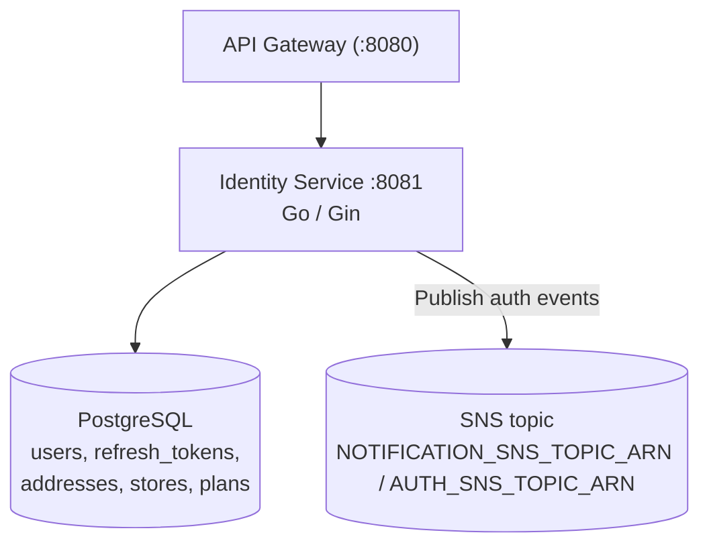

# 👤 Identity Service

The **ShopSwift Identity Service** owns authentication, user profiles, guest sessions, and multi-tenant store organizations. Built in **Go 1.26** with **Gin** and **GORM**, it runs on port `8081` (`PORT`) and uses PostgreSQL.

---

## 🏛️ Architecture



---

## 🛡️ Key Capabilities & Security

### 1. Refresh Token Family & Rotation
- Refresh tokens are tracked by family (`000004_refresh_token_family`).
- Reuse of a revoked or superseded refresh token invalidates the token family.

### 2. Login Lockout
- Repeated failed logins lock the account for a window (`000005_login_lockout`).

### 3. Verification Code Hardening
- Verification codes are stored as hashes (`000006_hash_verification_code`) and have an expiry (`000019_verification_code_expiry`).
- Verification endpoints are rate limited.

### 4. Guest Sessions (`POST /auth/guest`)
- Creates a guest identity for checkout without a full account.

### 5. User Search, Filter & Sort (`GET /users`, admin)
- Query params: `search` (case-insensitive `ILIKE` over `name`, `email`, `phone_number`), `role`, `sort`, `order`, `page`, `page_size` (default `20`).

### 6. Admin Bootstrap
- On startup, if `ADMIN_EMAIL` and `ADMIN_PASSWORD` are set **and** no user with role `admin` exists, the service creates that admin.
- If either variable is unset, or an admin already exists, bootstrap is skipped.
- `ADMIN_PASSWORD` must pass the password policy, or startup fails.

### 7. Multi-Tenant Stores
- Tables `stores`, `store_members`, `plans` (`000020` to `000022`); store scoping in `000021_store_scoping`.
- Store routes check membership and role (see HTTP surface).

---

## 📋 HTTP Surface

All routes are behind the API Gateway. Auth column: **Public**, **JWT** (any signed-in user), **Admin** (`role=admin`), **Mesh** (requires `INTERNAL_SERVICE_TOKEN`).

### Auth Routes (`/auth`)
| Method | Path | Auth | Description |
|:---|:---|:---:|:---|
| `POST` | `/auth/register` | Public | Register a customer (rate limited) |
| `POST` | `/auth/login` | Public | Log in, returns tokens (rate limited) |
| `POST` | `/auth/guest` | Public | Create a guest session (rate limited) |
| `POST` | `/auth/refresh` | Public | Rotate refresh token (rate limited) |
| `POST` | `/auth/verify-email` | Public | Verify email with code |
| `POST` | `/auth/resend-verification` | Public | Send a new verification code |
| `POST` | `/auth/logout` | Public (gateway enforces JWT) | Log out and revoke refresh token |
| `GET` | `/auth/status` | Mesh | Auth status lookup from gateway |
| `POST` | `/auth/admin/users` | Admin | Create a user as admin |

### User Routes (`/users`)
| Method | Path | Auth | Description |
|:---|:---|:---:|:---|
| `GET` | `/users/profile` | JWT | Current user's profile |
| `PUT` | `/users/profile` | JWT | Update current user's profile |
| `POST` | `/users/change-password` | JWT | Change password |
| `GET` | `/users` | Admin | Paginated, searchable, filterable user list |

### Store Routes
| Method | Path | Auth | Description |
|:---|:---|:---:|:---|
| `GET` | `/stores/by-slug/:slug` | Public | Public store lookup by slug |
| `GET` | `/plans` | Public | List subscription plans |
| `POST` | `/stores` | JWT | Create a store |
| `GET` | `/stores` | JWT | List stores for the user |
| `GET` | `/stores/:id` | JWT | Store details |
| `GET` | `/stores/:id/membership/me` | JWT | Current user's membership in the store |
| `PUT` | `/stores/:id` | JWT (store role) | Update store |
| `DELETE` | `/stores/:id` | JWT (store role) | Delete store |
| `GET` | `/stores/:id/members` | JWT (store role) | List members |
| `POST` | `/stores/:id/invite` | JWT (store role) | Invite a member |
| `PUT` | `/stores/:id/members/:userId` | JWT (store role) | Change member role |
| `DELETE` | `/stores/:id/members/:userId` | JWT (store role) | Remove member |
| `GET` / `PUT` | `/stores/:id/settings` | JWT (store role) | Read or update store settings |
| `GET` | `/stores/:id/subscription` | JWT (store role) | Store subscription |

"Store role" means the checks are done in the store service. The exact role per action is in `stores/` controllers.

---

## ⚙️ Configuration

| Environment Variable | Description | Default |
|:---|:---|:---|
| `PORT` | HTTP port | Set by deployment (`8081` in compose) |
| `POSTGRES_HOST`, `POSTGRES_PORT`, `POSTGRES_USER`, `POSTGRES_PASSWORD`, `POSTGRES_DB` | Database connection | — |
| `POSTGRES_SSLMODE`, `POSTGRES_TIMEZONE` | Optional DB connection settings | — |
| `JWT_SECRET` | Signs and verifies tokens. Startup fails if unset | *Required* |
| `INTERNAL_SERVICE_TOKEN` | Mesh token for `Mesh` routes | *Required* |
| `ADMIN_EMAIL` | Bootstrap admin email | Unset (bootstrap skipped) |
| `ADMIN_PASSWORD` | Bootstrap admin password | Unset (bootstrap skipped) |
| `ADMIN_NAME` | Bootstrap admin display name | `Administrator` |
| `ALLOW_AUTO_MIGRATE` | GORM auto-migrate on startup. `false`, `0` or `no` disables it | Enabled |
| `ENV` | `production` changes cookie settings | — |
| `COOKIE_DOMAIN`, `COOKIE_CROSS_ORIGIN` | Auth cookie scope | — |
| `NOTIFICATION_SNS_TOPIC_ARN` | SNS topic for auth events | Falls back to `AUTH_SNS_TOPIC_ARN` |
| `AUTH_SNS_TOPIC_ARN` | Fallback SNS topic | — |

Demo admin (`merchant.owner@shopswift-demo.test`) comes from `scripts/seed_postgres_data.sh`, not from this service.

---

## 🚀 Running Locally

```bash
cd backend/services/identity-service
go run .
```

Verify service health:
```bash
curl http://localhost:8081/health
```
