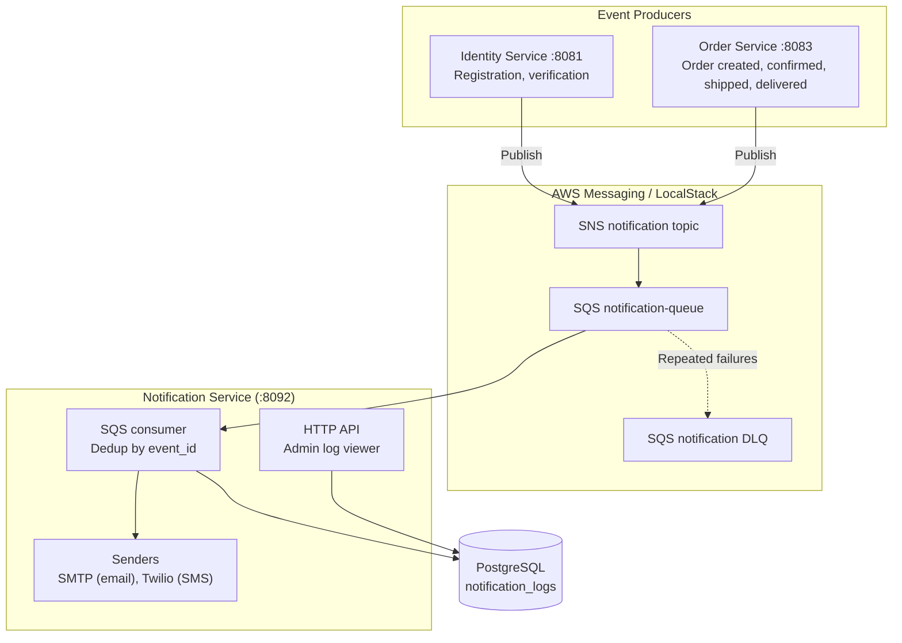

# 🔔 Notification Service

The **ShopSwift Notification Service** consumes notification events from SQS and sends email (SMTP) and SMS (Twilio). It logs each delivery in PostgreSQL. Built in **Go 1.26** with **Gin**, it runs on port `8092` (`PORT`).

---

## 🏛️ Architecture



---

## ⚡ Core Capabilities

### 1. Event-Driven Notifications
Each message has an `event_type`. The service looks up a config for that type that sets:
- the HTML template (`templates/*.html`),
- the subject,
- the channels (email, SMS),
- the recipient field (`email` or `phone`).

Event types with configs include `order_created` (email and SMS), `order_confirmed`, `order_shipped`, `order_delivered`, and `user_registered`. Other templates exist for `verification_resend`, `payment_failed`, `coupon_applied`, and `price_drop_refund`. Unknown event types are rejected with an error.

### 2. Deduplication
- Each event has an `event_id`. The service claims it in `notification_logs` before sending, so a duplicate SQS delivery does not send a second email.
- If sending fails, the claim is released so the message can be retried.

### 3. Retries and DLQ
- Failed messages are not acknowledged, so SQS redelivers them.
- Messages that keep failing move to the dead letter queue. The redrive setting lives in the infrastructure config (Terraform / LocalStack init), not in this service.

### 4. Correlation
- `correlation_id` is read from the message (or generated from `event_id`) and stored with each log row.

---

## 📋 HTTP Surface

| Method | Path | Auth | Description |
|:---|:---|:---:|:---|
| `GET` | `/health` | Public | Liveness check |
| `GET` | `/health/live` | Public | Liveness probe |
| `GET` | `/health/ready` | Public | Readiness probe |
| `GET` | `/notifications/log` | JWT + Admin | Paginated delivery log |

The gateway exposes this as `/notifications/log` (admin) and `/bff/admin/notifications/log`.

---

## ⚙️ Configuration

| Environment Variable | Description | Default |
|:---|:---|:---|
| `PORT` | HTTP port | `8092` |
| `POSTGRES_HOST`, `POSTGRES_USER`, `POSTGRES_PASSWORD`, `POSTGRES_DB` | Database connection | — |
| `POSTGRES_PORT` | Database port | `5432` |
| `POSTGRES_SSLMODE` | SSL mode | `disable` |
| `POSTGRES_TIMEZONE` | Timezone | `UTC` |
| `NOTIFICATION_SQS_QUEUE_URL` | Queue to consume (or `SQS_QUEUE_URL`) | `notification-queue` |
| `ENABLE_SQS_CONSUMER` | Set to `false` to disable the consumer | Enabled |
| `SMTP_HOST`, `SMTP_PORT` | SMTP server | — |
| `SMTP_EMAIL`, `SMTP_PASSWORD` | SMTP login | — |
| `TWILIO_ACCOUNT_SID`, `TWILIO_AUTH_TOKEN`, `TWILIO_FROM_NUMBER` | SMS sending | — |

---

## 🚀 Running Locally

```bash
cd backend/services/notification-service
go run .
```

Verify service health:
```bash
curl http://localhost:8092/health
```
