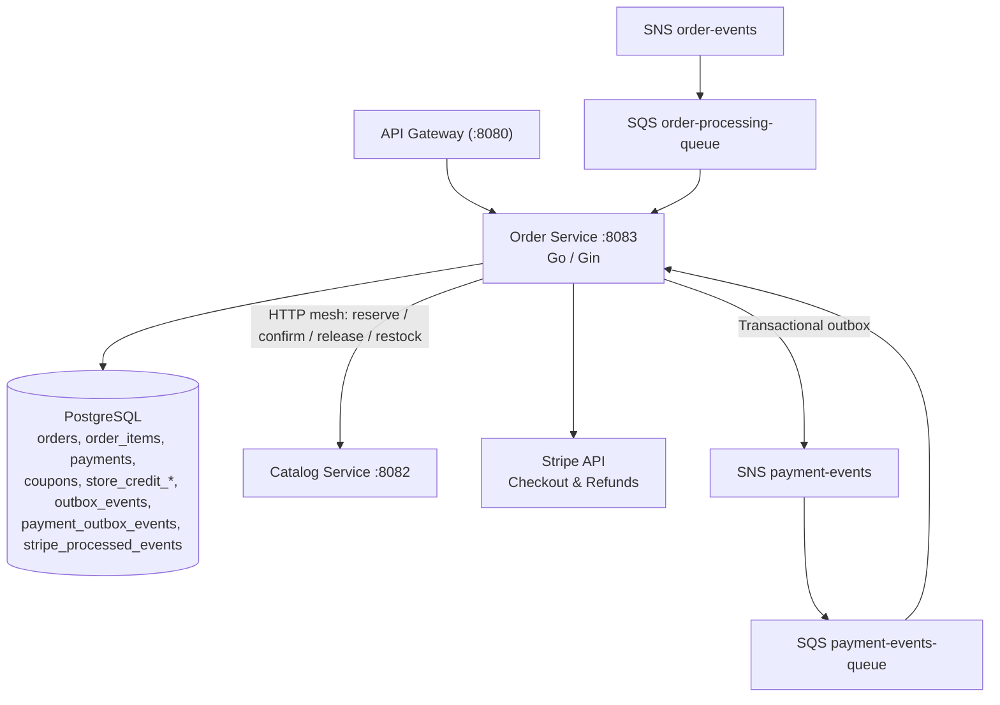
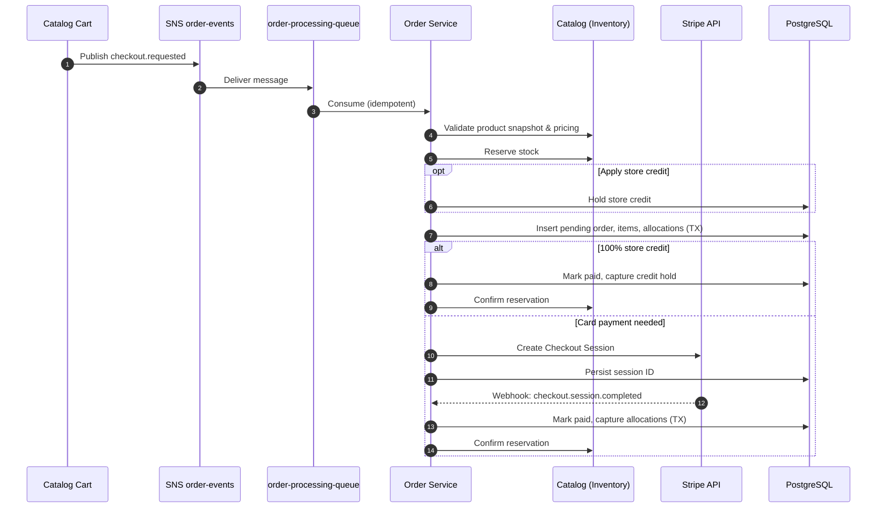

# 🛒 Order Service

The **ShopSwift Order Service** handles orders, store credit, coupons, shipping rates, Stripe payments, and refunds. Built in **Go 1.26** with **Gin**, **GORM**, and the **Stripe SDK**, it runs on port `8083` (`PORT`) with PostgreSQL persistence and SQS/SNS messaging.

---

## 🏛️ Architecture



---

## ⚡ Core Capabilities

### 1. Store Credit (`000025_store_credit`)
- **Integer minor units**: balances are stored as `available_amount` and `held_amount`, with no floating-point math.
- **Append-only ledger** (`store_credit_ledger`): each change (`grant`, `debit`, `hold`, `capture`, `release`, `refund`) is a new row with a unique idempotency key, reason, and admin audit metadata.
- **Split tender** (`order_payment_allocations`): an order can be paid partly with store credit and partly with Stripe.
- **100% store credit**: if store credit covers the whole order, the order is marked `paid` and Stripe is skipped.
- **Hold and release**: checkout places credit on hold. Payment success captures the hold. Failure or expiry releases it back to `available_amount`.

### 2. Refunds (`POST /orders/:id/refund`)
- Optional body `{"amount": <minor_units>, "reason": "<reason>"}`. Without `amount`, the refund is full.
- Partial refunds must be ≤ the unrefunded total.
- Only orders in `paid`, `fulfilled`, or `completed` can be refunded. Others get `409 Conflict`.
- Calls Stripe `refund.New` with an idempotency key, using the order's PaymentIntent ID.
- Restocks returned items through catalog-service.
- Updates `orders.refunded_amount` and `payments.refunded_amount`, and writes a `payment_refunded` outbox event.
- This route requires the mesh token (`internalauth.Require()`). The gateway forwards it with the mesh credential. Direct calls without it are rejected.

### 3. Stripe Checkout & Webhooks
- Creates Stripe Hosted Checkout sessions with shipping details and prefilled email.
- Success and cancel redirects use `FRONTEND_URL` (or `STOREFRONT_URL`), falling back to `http://localhost:3001`. Never point this at the admin app.
- `POST /stripe/webhook` verifies the signature with `STRIPE_WEBHOOK_SECRET` and deduplicates events in `stripe_processed_events` before changing order state.

### 4. Transactional Outbox
- Order and payment events are written to `outbox_events` and `payment_outbox_events` in the same transaction as the business change.
- A background worker claims events with lease locks, publishes them to SNS, and marks them published after confirmation.
- Delivery is at-least-once.

### 5. Basket Optimizer (`POST /promotions/optimize-basket`)
- Calculates bundle discounts, multi-buy savings, and free-shipping thresholds in-process.

---

## 🔄 Checkout Flow



---

## 📋 HTTP Surface

Auth column: **Public** (no check in this service), **JWT** (auth middleware; gateway also checks), **Admin** (`role=admin`), **Mesh** (`INTERNAL_SERVICE_TOKEN`). The gateway enforces JWT and admin checks before forwarding.

### Orders (`/orders`)
| Method | Path | Auth | Description |
|:---|:---|:---:|:---|
| `GET` | `/orders/` | JWT | List the user's orders |
| `GET` | `/orders/:id` | JWT | Order detail |
| `PUT` | `/orders/:id/cancel` | Admin | Cancel order and release reserved stock |
| `POST` | `/orders/:id/refund` | Mesh | Full or partial Stripe refund |
| `GET` | `/orders/admin/` | Admin | All orders (admin view) |
| `GET` | `/orders/admin/stats` | Admin | Revenue and order stats |
| `GET` | `/orders/admin/dashboard` | JWT + Admin | Dashboard KPIs (registered outside the `/orders` group) |

### Store Credit (`/store-credit`, mesh token required on every route)
| Method | Path | Auth | Description |
|:---|:---|:---:|:---|
| `GET` | `/store-credit/balance` | JWT | Available and held balance |
| `GET` | `/store-credit/ledger` | JWT | Ledger history |
| `POST` | `/store-credit/grants` | Admin | Issue credit with audit note |
| `POST` | `/store-credit/adjustments` | Admin | Adjust balance with required reason |
| `POST` | `/store-credit/hold` | Mesh | Hold credit during checkout |
| `POST` | `/store-credit/release` | Mesh | Release a hold |
| `GET` | `/store-credit/reconcile` | Admin | Reconcile ledger against balances |

### Coupons (`/coupons`)
| Method | Path | Auth | Description |
|:---|:---|:---:|:---|
| `POST` | `/coupons/validate` | Public | Validate a coupon |
| `GET` | `/coupons/:code` | JWT | Coupon details |
| `GET` | `/coupons` | Admin | List coupons |
| `POST` | `/coupons` | Admin | Create coupon |
| `DELETE` | `/coupons/:code` | Admin | Deactivate coupon |

### Promotions
| Method | Path | Auth | Description |
|:---|:---|:---:|:---|
| `POST` | `/promotions/optimize-basket` | Public | Basket optimizer |

### Shipping & Payments
| Method | Path | Auth | Description |
|:---|:---|:---:|:---|
| `POST` | `/shipping/rates` | JWT | Shipping rates for a zone |
| `POST` | `/payment/create-checkout` | JWT | Create Stripe Checkout session |
| `GET` | `/payment/status/by-order/:order_id` | JWT | Poll payment status |
| `POST` | `/payment/verify-payment` | JWT | Verify payment intent |
| `GET` | `/payment/methods` | JWT | Saved payment methods |
| `POST` | `/payment/methods` | JWT | Save a payment method |
| `DELETE` | `/payment/methods/:id` | JWT | Delete a saved payment method |
| `POST` | `/stripe/webhook` | Public (signature verified) | Stripe webhook ingress |

---

## ⚙️ Configuration

| Environment Variable | Description | Default |
|:---|:---|:---|
| `PORT` | HTTP port | `8083` |
| `POSTGRES_HOST`, `POSTGRES_USER`, `POSTGRES_PASSWORD`, `POSTGRES_DB` | Required database settings | — |
| `POSTGRES_PORT` | Database port | `5432` |
| `POSTGRES_SSLMODE` | SSL mode | `disable` |
| `POSTGRES_TIMEZONE` | Timezone | `Asia/Kolkata` |
| `STORE_CURRENCY` | Currency code | `USD` |
| `STRIPE_API_KEY` | Stripe secret key (`sk_test_...`) | — |
| `STRIPE_WEBHOOK_SECRET` | Webhook signing secret (`whsec_...`) | — |
| `FRONTEND_URL` / `STOREFRONT_URL` | Stripe redirect base URL | `http://localhost:3001` |
| `PRODUCT_SERVICE_URL` | Catalog base URL | `http://catalog-service:8082` |
| `INVENTORY_SERVICE_URL` | Inventory base URL (catalog) | `http://catalog-service:8082` |
| `USER_SERVICE_URL` / `IDENTITY_SERVICE_URL` | Identity base URL for store credit lookups | — |
| `CHECKOUT_QUEUE_URL` | Queue for checkout events | `order-processing-queue` |
| `PAYMENT_EVENTS_QUEUE_URL` | Queue for payment outcome events | `payment-events-queue` |
| `PAYMENT_REQUEST_QUEUE_URL` | Queue for payment requests | `payment-request-queue` |
| `ORDER_CREATED_QUEUE_URL` | Queue for order-created events | — |
| `ORDER_SNS_TOPIC_ARN` | Order events topic | `order-events` |
| `PAYMENT_SNS_TOPIC_ARN` | Payment events topic | `payment-events` |
| `NOTIFICATION_SNS_TOPIC_ARN` | Notification topic | `notification-queue` |
| `INTERNAL_SERVICE_TOKEN` | Mesh token | *Required* |

---

## 🚀 Running Locally

```bash
cd backend/services/order-service
go run .
```

Run tests:
```bash
go test -v ./...
```
